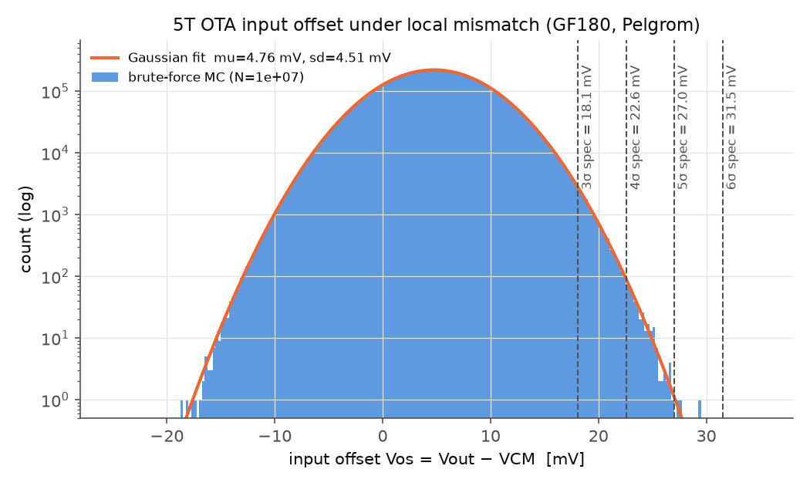
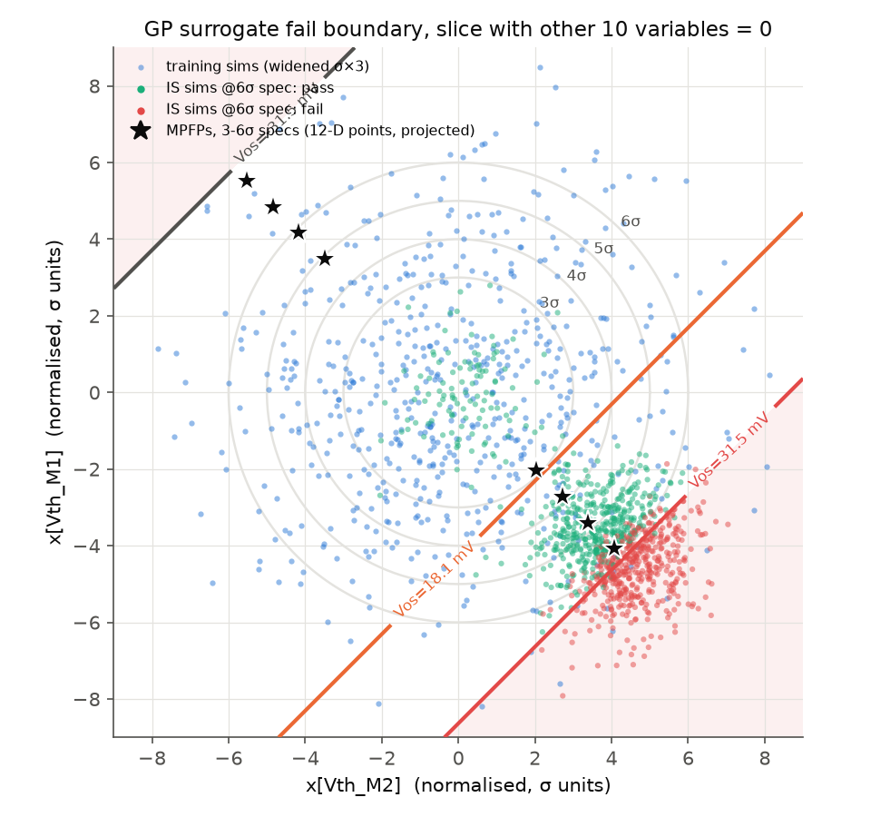
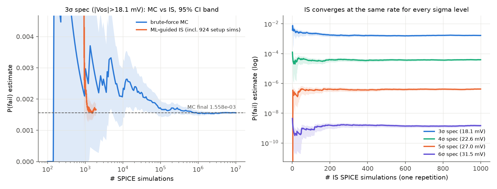

# High-sigma Monte Carlo for OTA input offset (GF180MCU)

**What:** estimate the probability that a 5-transistor OTA's input offset exceeds a spec
at the **4, 5 and 6 sigma** level (failure probabilities of 1e-5 down to 1e-9). The method
is ML-guided importance sampling, and every number is checked against brute-force Monte
Carlo where that's affordable.

**Why:** blocks that are repeated many times or shipped in huge volumes (SRAM cells,
comparators in an ADC, offset-trimmed amplifiers) must fail extremely rarely. Plain Monte
Carlo needs ~400/P simulations for ±10% accuracy. At 6 sigma (P≈1e-9) that's ~4e11 SPICE runs,
about 25 CPU-years. Commercial tools (Solido High-Sigma Monte Carlo, Cadence Spectre's
scaled-sigma sampling / worst-case distance) exist to close that gap. This project rebuilds the
textbook version from scratch with open-source tools: **ngspice + GF180 PDK + scikit-learn**.

**Result in one line:** at the 6 sigma spec, P(fail) = **1.49e-9 (95% CI 1.40–1.58e-9)**
from **~5,900 SPICE sims**. Brute force would need **~2.6e11** sims for ±10%. Where brute force can
still see failures (3σ, 4σ and 5σ, using 1e7 samples in 77 min), the IS estimate falls inside its
confidence interval.

Part of a portfolio. The design under test is the gm/Id hand design from
[`../analog_agent`](../analog_agent) (project 1: LLM-agent OTA sizing + layout).

---

## Method

```
x ~ N(0, I_12)           12 normalised mismatch variables: dVth and dbeta of M1..M6
   │  Pelgrom: dVth_i = σVth_i·x_i,  dβ_i = σβ_i·x_{6+i}   (σ from the PDK's own coefficients)
   ▼
ngspice: 250 OTA copies per netlist, unity-gain follower, one .op  →  Vos = Vout − VCM
   │  12 cores in parallel, ~2 ms per sample
   ▼
1. explore   600 sims from a widened Gaussian N(0, 3²I), to reach the tails
2. learn     Gaussian-process regression Vos ≈ g(x)  (linear + ARD-RBF kernel)
             classifier = |g(x)| > spec; checked on 300 held-out sims
3. MPFP      most probable failure point per spec and side: min |x|² s.t. g(x)=±spec
             (HL-RF / FORM iteration on the surrogate, then 3 SPICE sims to correct it)
4. IS        q(x) = 0.1·N(0,I) + 0.9·Σ_side w_side·N(x*_side, I)
             P = mean(fail(x)·p(x)/q(x)), pass/fail always from SPICE, 5 × 1000 sims per spec
```

* **Mismatch model.** The GF180 ngspice models include their own Pelgrom mismatch (`fets_mm`
  section, `sw_stat_mismatch`). Its coefficients: A_VT = 7.15 / 6.66 mV·µm and A_β = 0.70 / 0.28 %·µm
  for nfet/pfet_03v3. We use the same formula and coefficients but draw the random numbers
  ourselves, because importance sampling has to *choose* the samples. Check (step 1): offset std is
  4.45 mV (ours) vs 4.67 mV (PDK `agauss`). The 5% gap is a known quirk of the PDK wrapper: for
  multi-finger devices it uses per-finger area, which adds √2 too much mismatch on the 2-finger
  M3/M4. Accounting for that predicts 4.61 mV.
* **Specs.** Fail if |Vos| > spec, with spec_k = mean + k·std of a quick 3000-sample MC
  (18.1 / 22.6 / 27.0 / 31.5 mV for k = 3…6). Because of the +4.8 mV systematic offset, the
  negative side is 2 sigma further away. The method still finds and samples both sides.
* **Why the surrogate is safe.** It only decides *where* to sample. Every IS sample's pass/fail
  comes from SPICE, and the p/q weights keep the estimate unbiased for any proposal. A poor surrogate
  widens the CI but can't shift the answer. The 10% nominal component bounds the weights (≤10).

## Results

| spec (target σ) | \|Vos\| > | brute force MC, N=1e+07: P [95% CI] (fails) | ML-guided IS: P [95% CI] | σ-equiv. (IS) | FORM Φ(−β) | Gaussian fit | IS SPICE sims | brute-force sims for ±10% |
|---|---|---|---|---|---|---|---|---|
| 3σ (Φ(−3) = 1.35e-03) | 18.1 mV | 1.56e-03 [1.53e-03, 1.58e-03] (15578) | **1.61e-03** [1.50e-03, 1.71e-03] | 2.95 | 1.54e-03 | 1.54e-03 | 5006 (+900 shared) | 2.39e+05 |
| 4σ (Φ(−4) = 3.17e-05) | 22.6 mV | 3.76e-05 [3.40e-05, 4.16e-05] (376) | **3.62e-05** [3.47e-05, 3.77e-05] | 3.97 | 3.76e-05 | 3.78e-05 | 5006 (+900 shared) | 1.06e+07 |
| 5σ (Φ(−5) = 2.87e-07) | 27.0 mV | 3.00e-07 [1.02e-07, 8.82e-07] (3) | **4.12e-07** [3.70e-07, 4.55e-07] | 4.93 | 3.99e-07 | 4.02e-07 | 5006 (+900 shared) | 9.32e+08 |
| 6σ (Φ(−6) = 9.87e-10) | 31.5 mV | < 3.84e-07 (0 fails) | **1.49e-09** [1.40e-09, 1.58e-09] | 5.93 | 1.47e-09 | 1.49e-09 | 5006 (+900 shared) | 2.58e+11 |

(Auto-generated version with the latest numbers: [`results/results_table.md`](results/results_table.md).)

* **Sims needed for ±10% (95%) with IS:** ≈1.4k (3σ), 2.0k (4σ), 2.4k (5σ), 2.9k (6σ). The cost
  barely grows with sigma, while brute force grows as 1/P. At 6σ that's ~10^8× fewer sims.
* **Repeatability:** 5 independent IS runs per spec. At 6σ they give 1.38–1.64e-9, consistent with
  the per-run ±17% CI.
* **Surrogate:** held-out RMSE 0.5 µV over a ±30 mV range; the classifier is 100% accurate on held-out
  sims at every spec. The 6σ MPFP direction is (Vth_M1, Vth_M2, Vth_M3, Vth_M4) ≈ (−0.69, +0.69,
  −0.16, +0.16), with everything else < 0.06. Offset is the input pair plus the load scaled by
  gm3/gm1, as hand analysis predicts. The tail transistors don't matter.
* **Honest reading:** this offset is almost linear in the mismatch variables, so the tail
  *is* Gaussian. FORM Φ(−β) and a Gaussian fit of the 1e7 MC agree with IS within a few percent.
  The demo shows that the machinery works and is validated. It does *not* show a case where
  Gaussian extrapolation fails (see limitations).

| | |
|---|---|
|  |  |
|  |  |

1. Offset histogram (1e7 MC, log scale) with Gaussian fit and spec lines.
2. Surrogate fail boundary in the two most important variables (Vth of M1, M2). The circles are
   sigma contours, the stars are MPFPs, and the dots are training sims and the 6σ IS cloud.
3. Convergence: at 3σ brute force needs ~1e5–1e7 sims to settle, while IS settles in ~1e3. On the right,
   IS converges about equally fast at every sigma level.
4. P(fail) vs spec: brute force, IS, FORM and Gaussian fit.

## How to run

Everything runs inside the IIC-OSIC-TOOLS container (ngspice-47, GF180 PDK, Python 3.12 with
numpy/scipy/matplotlib/scikit-learn):

```bash
docker start iic-osic-tools_shell_uid_1000
docker exec iic-osic-tools_shell_uid_1000 bash -lc 'cd /foss/designs/highsigma_mc && ./run_all.sh'
```

or step by step (inside the container, in `/foss/designs/highsigma_mc`):

| step | command | time (12 cores) | output |
|---|---|---|---|
| 0 | `python3 -m hsmc.ota_mc` | 1 s | sigmas, nominal offset, batch sanity check |
| 1 | `python3 scripts/01_check_mismatch.py` | 5 s | `results/01_mismatch_check.json` |
| 2 | `python3 scripts/02_brute_mc.py 1000000` (results use 1e7: ~77 min) | ~10 min | `results/02_brute_mc.{json,npz}` |
| 3 | `python3 scripts/03_highsigma_is.py` | ~2 min | `results/03_highsigma_is.json`, IS samples, GP |
| 4 | `python3 scripts/04_plots.py` | 10 s | `results/fig*.png` |
| 5 | `python3 scripts/05_table.py` | 1 s | `results/results_table.md` |

Code: [`hsmc/ota_mc.py`](hsmc/ota_mc.py) (mismatch model, batched netlist, parallel runner, specs)
and [`scripts/`](scripts). Concepts and interview Q&A: [`NOTES.md`](NOTES.md).

## Limitations (honest)

* **Near-linear metric.** DC offset depends almost linearly on dVth, so Gaussian extrapolation
  would have worked too. High-sigma methods earn their keep on non-Gaussian metrics (SRAM read/write
  margins, comparator decisions, anything with clipping or min/max). The natural next step is to apply
  the same pipeline to such a metric.
* **Pre-layout, local mismatch only.** No layout effects (gradients, LOD/WPE), no global process
  variation (you'd repeat the analysis per global corner), DC only, typical corner, 27 °C.
* **Statistics assumed Gaussian out to 6σ.** The Pelgrom model is characterised by the foundry at
  a few sigma; its tails at 6σ are an extrapolation, as in every high-sigma flow.
* **Direct validation stops at 5σ.** 1e7 brute-force samples give 15,578 / 376 / 3 failures at
  3σ / 4σ / 5σ, and zero at 6σ. The 5σ check rests on only 3 failures (a wide CI). 6σ is checked only
  indirectly (FORM, Gaussian fit, repeatability across seeds).
* **Low dimension (12).** Mean-shift IS is easy here. Hundreds of variables (a whole SRAM column)
  would need variable screening, or scaled-sigma sampling / subset simulation.
* One design, one spec type. Not a product.
